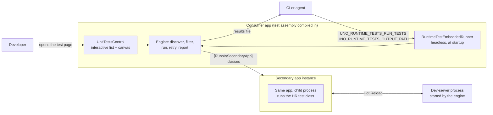

# 004 — Runtime tests engine: architecture reference

> State as of 2026-10-19. How the engine is built, and why. The user documentation (setup, attributes, CI) is the
> repository's [README](../../README.md). When the code diverges, update this page rather than leaving it stale.

The **runtime tests engine** runs MSTest-style tests *inside a running Uno app*, on every platform, with the real
visual tree, dispatcher, input and Hot Reload. It sits between unit tests (no app) and UI tests (driving the app from
outside). `uno.extensions` and `uno.toolkit.ui` use it, and their Hot Reload test suites run on it in CI. Hot Testing
is its MSTest-based successor.

- [Why it exists](#why-it-exists)
- [Packaging: a source package](#packaging-a-source-package)
- [Three ways to run](#three-ways-to-run)
- [What a test can use](#what-a-test-can-use)
- [Execution model](#execution-model)
- [Hot Reload tests: the secondary app](#hot-reload-tests-the-secondary-app)
- [Code map](#code-map)
- [Decisions not to reopen](#engine-decisions-not-to-reopen)
- [Traps](#traps)
- [Open items](#engine-open-items)

## Why it exists

- **Unit tests** cannot test what depends on a live visual tree: layout, `Loaded`, the dispatcher, pointers,
  Hot Reload.
- **UI tests** (Selenium, Xamarin.UITest) drive the app from outside through an automation API. They are slow,
  limited to what that API exposes, and blind to internal state.
- **A runtime test** is ordinary C# that runs inside the app. It can build a control, put it in the window, inject
  pointer input, wait for idle, take a bitmap and assert on any object. Pointer injection made scenarios testable
  that no UI test reached, and found bugs nobody had seen manually (2023).

The idea behind it is that the distinction between UI tests and runtime tests disappears once you have a driver and a
communication tunnel into the app (2023-04).

## Packaging: a source package

The engine ships as **sources** compiled into the consumer's test assembly, not as a binary. The sources live in a
shared project (`Uno.UI.RuntimeTests.Engine.Library.projitems`), and `buildTransitive/Uno.UI.RuntimeTests.Engine.targets`
wires them into the consumer.

Why sources: a binary engine depends on Uno, so it cannot be used to test Uno itself; compiled from sources, it
breaks that loop, and one package served both the UWP and WinUI flavours of the time. The first goal was never
reached: `uno` kept its own runner (see Traps). The choice has a cost. Consequences:

- It compiles against **whatever Uno the consumer uses**, UWP or WinUI flavour (#118), with or without implicit
  `global using` (#119). This is why it has no binary dependency matrix to maintain.
- Variations that were `#if` constants became **runtime detection** (#121, secondary app). The same compiled engine
  has to behave correctly in every configuration of its host.
- **Anything `public` is API surface for every consumer.** Keep new types and members `internal` unless they are
  meant for test authors (review of #224). Even `internal` protects little: the code is compiled into the app, so
  the app's own code can reach it.
- **Preprocessor constants must match.** The sources are full of `#if`; a project that compiles them with other
  defines than the rest of the solution gets another engine, or a build error.
- The code is split in two (#65):
  - `Library/` holds what test code references: attributes and helpers.
  - `Engine/` holds the runner and its UI.

  A separate test assembly defines `UNO_RUNTIMETESTS_DISABLE_UI` and the app hosting it defines
  `UNO_RUNTIMETESTS_DISABLE_LIBRARY`, so the helpers compile once and the runner is not pulled into the test assembly.

## Three ways to run

1. **Interactive.** The app hosts `UnitTestsControl`, which lists the test classes, runs them and shows the output,
   with a content area where tests put their UI.
2. **Headless, at app startup.** `RuntimeTestEmbeddedRunner` is a `[ModuleInitializer]`. When
   `UNO_RUNTIME_TESTS_RUN_TESTS` is set, it waits for `Window.Current` and its dispatcher (30 s), then for its content
   (5 s), creates a `UnitTestsControl` on that dispatcher, runs the tests,
   writes the results to `UNO_RUNTIME_TESTS_OUTPUT_PATH` (NUnit by default, `UNO_RUNTIME_TESTS_OUTPUT_KIND`), and
   the app exits. The variable takes:
   - a JSON `UnitTestEngineConfig`, e.g. `{"Filter": {"Value": "_HotReload"}, "Attempts": 1}`; `{}` runs everything
     with the defaults;
   - a filter string;
   - a bool: `true` runs everything, `false` aborts.

   On WebAssembly the app cannot write a file: results are POSTed to `UNO_RUNTIME_TESTS_OUTPUT_URL`.

   This is the CI path in every library, and the one an agent can drive alone. Prefer adding fields to this JSON
   over new environment variables. The sharding PR (#214) added dedicated variables (`UNO_RUNTIME_TESTS_SHARD_INDEX`, `UNO_RUNTIME_TESTS_TOTAL_SHARDS`,
   1-based, while `ShardIndex` in the JSON is 0-based) for CI simplicity, accepted as a pragmatic exception.
3. **WebAssembly runner.** `Uno.UI.RuntimeTests.Engine.Wasm.Runner` launches the app in a browser for CI and
   collects the results. It supports **sharding**: a stable hash of the test name spreads tests across N jobs
   (#214, [spec 002](../002-sharding/spec.md)). Its specs: [000-wasm-runtime-tests](../000-wasm-runtime-tests/spec.md),
   [001-aot-profile-extraction](../001-aot-profile-extraction/spec.md), [002-sharding](../002-sharding/spec.md).

**Filtering** (`UnitTestFilter`) accepts negative patterns (#133), so CI can exclude tests without keeping an
explicit list.

## What a test can use

| Need | Use |
|---|---|
| Run on the UI thread | `[RunsOnUIThread]`, on a test or a class: the dispatcher of the window that hosts the `UnitTestsControl`. **Tests run off the dispatcher by default** |
| Own the whole window (full screen, navigation) | `[RequiresFullWindow]`: the engine saves and restores `Window.Content` (`UnitTestsUIContentHelper`) |
| Put UI in the test area and wait for it | `UIHelper` (content, `WaitForLoaded`, `WaitForIdle`) |
| Inject mouse, touch or pen | `InputInjectorHelper` (mouse helper and extensions). `[InjectedPointer(type)]` is legacy: it was added to port the Xamarin.UITest suites, whose `Tap` ran once per pointer type (mouse, finger, pen; default: touch on mobile, mouse elsewhere). New tests inject the pointer they need explicitly |
| Compare pixels | `TestBitmap`, `ImageAssert`, imported from `uno` (#103) |
| Assert on something that settles asynchronously | `AsyncAssert` |
| Edit source and wait for Hot Reload | `HotReloadHelper`, local file system or through the dev-server (#103) |
| Data-driven tests | `[DataRow]`, `[DynamicData]` (#161) |
| A time budget | `[Timeout(ms)]` (#197); with `CooperativeCancellation = true`, the test class declares `public TestContext TestContext { get; set; }` and watches its token, as in MSTest (MSTEST0045) (#224) |
| A `CancellationToken` | Declare it as a test method parameter and the engine injects one. **Engine only**: MSTest does not support it, so such a test does not run unchanged on MSTest. Prefer `[Timeout(..., CooperativeCancellation = true)]` with `TestContext` |

## Execution model

The engine is **its own runner**. It reads MSTest's attributes but does not run on MSTest. Every MSTest semantic
it honours is reimplemented in `UnitTestsControl` / `UnitTestMethodInfo`, and every gap is a behaviour difference
nobody sees until a test relies on it. The `[Timeout]` story shows the cost: unsupported until 2026-03 (#197), a
cooperative mode that did not match MSTest (#219), and a rework (#224) found by running the same suite on Microsoft
Testing Platform.

- **Isolation is a contract on test authors.** A test must run alone, in any order, and in parallel, with no state
  shared between tests (2022-11, restated 2026-09).
- **One test class instance per class**, reused across its tests and their retries: `UnitTestsControl` calls
  `Activator.CreateInstance` once per class (checked on `main` at `fbec0d0b`, 2026-10-08). Instance fields survive
  from one test to the next. MSTest creates one instance per test (see Open items).
- **One dispatcher.** `[RunsOnUIThread]` runs on the dispatcher of the window that hosts the `UnitTestsControl`; the
  control publishes it in a static when it initializes, so `UIHelper` can reach it. Several windows with distinct
  dispatchers are not handled (Uno's windows share one dispatcher today).
- **Retries**: a test can be attempted several times (`Attempts` in the run config), except when a debugger is
  attached.
- **Timeouts**: `DefaultUnitTestTimeout` applies unless `[Timeout]` overrides it, for the execution step only, not
  for initialize or cleanup (#197).
- **`WaitForIdle` waits for the dispatcher to be idle**, not for a frame to render. The frame-based version was a
  source of flaky tests (#157).

## Hot Reload tests: the secondary app

A Hot Reload test modifies the app's own code, so it cannot run in the instance hosting the test runner. Such a class
carries `[RunsInSecondaryApp]`. It is class-level only, since starting an app is costly, and all tests of the class
share one secondary instance; `ignoreIfNotSupported: true` skips it on platforms that cannot start one. For those
classes the engine (`Engine/ExternalRunner`):

1. starts a **dev-server** process (`DevServer`, configured through `RuntimeTestDevServerAttribute`; detection of
   the dev-server package is disabled on Windows, #175) and waits until its port is bound (#215);
2. launches a **secondary instance of the same app** (`SecondaryApp`, `ProcessHelper`), connected to that dev-server,
   with the source project given by `RuntimeTestsSourceProjectAttribute`;
3. runs only that test class there, in headless mode, and reads its results back.

Detecting that we *are* the secondary instance is done at runtime (#121). The engine supports **nested** instances
(#131), which the Hot Reload CI of `uno` needed.

- **A child process.** The secondary app is a new process, child of the app that runs the tests: killing the parent
  kills it too.
- **Visible only under a debugger.** The secondary window is shown when a debugger is attached to the parent and
  hidden otherwise, unless the run config forces it (`IsSecondaryAppVisible`, tri-state, #166).
- **Not debuggable.** Attaching a debugger to the secondary app makes the runtime refuse the dev-server's deltas, so
  its Hot Reload tests fail.
- **Needs the sources and a Debug build.** The tests edit the app's source files on disk and wait for Hot Reload:
  the machine running them needs the sources, and the app must be a Debug build. On CI the app is built in Debug,
  started once, and starts the secondary app (the `uno` repo's own CI has a Release opt-in, uno#14374).
- **An ALC instead of a process?** Running the app under test in a collectible ALC instead of a second process
  (start it, kill it, as often as needed) would generalise the secondary app, but it cannot be imposed on every app:
  code that creates its own non-collectible ALC fails there, because the runtime refuses a reference from a
  non-collectible context to a collectible one. The Uno dev-server hit this with Roslyn 5.x analyzers
  ([uno#23863](https://github.com/unoplatform/uno/pull/23863)).

## Code map

All paths under [`src/Uno.UI.RuntimeTests.Engine.Library/`](../../src/Uno.UI.RuntimeTests.Engine.Library).

| Path | Role |
|---|---|
| `Engine/UI/UnitTestsControl.cs` (+ `.TestRun.cs`, `.CustomConsoleOutput.cs`, `.xaml`) | The runner: discovery, invocation (`DoInvoke`), timeout and retry, output |
| `Engine/UnitTestClassInfo.cs`, `Engine/UnitTestMethodInfo.cs` | What the runner knows about a class and a method (attributes, cases, timeout) |
| `Engine/UnitTestFilter.cs`, `Engine/UnitTestEngineConfig.cs`, `Engine/UnitTestContext.cs` | Filter syntax, run config (the JSON of `UNO_RUNTIME_TESTS_RUN_TESTS`), MSTest `TestContext` |
| `Engine/ExternalRunner/RuntimeTestEmbeddedRunner.cs`, `_Private/WasmTestResultReporter.cs` | Headless run at startup, results file or POST (WASM) |
| `Engine/ExternalRunner/_Private/DevServer.cs`, `SecondaryApp.cs`, `ProcessHelper.cs` | Secondary app and dev-server for Hot Reload tests |
| `Engine/UI/UnitTestsUIContentHelper.cs` | Test content area, save and restore of `Window.Content` |
| `Library/*Attribute.cs` | `RunsOnUIThread`, `RequiresFullWindow`, `InjectedPointer`, `RunsInSecondaryApp` |
| `Library/Helpers/` | `UIHelper`, `TestBitmap`, `ImageAssert`, `AsyncAssert`, `InputInjectorHelper*`, `HotReloadHelper` (`.Local`, `.DevServer`, `.MetadataUpdateHandler`, `.NotSupported`) |

Outside the library:
- `src/TestApp` is the engine's own test app;
- `src/MSTestLifcycleTests` holds the lifecycle tests;
- `src/Uno.UI.RuntimeTests.Engine.Wasm.Runner` (+ `.Tests`) is the WebAssembly runner, shipped as `uno-runtimetests-wasm`;
- `src/Uno.UI.RuntimeTests.Engine.Package` is the source package.

The repository's [README](../../README.md) is the user documentation (setup, attributes, CI examples for GitHub
Actions and Azure Pipelines, WASM runner options, sharding).

## Engine decisions not to reopen

| Date | Decision | Why |
|---|---|---|
| 2022-11 | Each test runs independently, with no shared state | The engine is embedded in a user app, where nothing else guarantees a reset between tests |
| 2022-12 | `Library/` (attributes, helpers) separate from the runner UI (#65) | Non-UI assemblies reference the helpers without the control |
| 2023-09 | Tests are deployed into the target app (through the dev-server's remote control), not run from a separate test app | One app to build; the remote-control client works outside debug, only server discovery is debug-only |
| 2023-10 | Hot Reload tests run in a secondary instance of the same app (#103) | A test that edits the app's code cannot run in the instance that hosts the runner |
| 2023-11 | Secondary app detected at runtime, not by `#if` (#121) | A source package compiles into hosts it cannot predict |
| 2023-12 | `WaitForIdle` checks the dispatcher is idle (#157) | Waiting for a frame was flaky |
| 2026-09 | MSTest semantics are the reference when the engine honours an MSTest attribute (#224, MSTEST0045) | Tests must keep the same behaviour on the engine and on Microsoft Testing Platform |

## Traps

- **Shared instance per class.** Anything a test stores on `this`, a `TestContext` included, is still there for the
  next test of the class and for `[TestCleanup]`. A disposed `CancellationTokenSource` behind a `TestContext` was one
  of the two blockers of #224.
- **A cooperative timeout needs an observer.** With `CooperativeCancellation = true` and no `TestContext` property,
  nothing watches the token. The engine must still enforce the timeout, otherwise the run hangs instead of failing
  (blocker on #224).
- **Hangs cost more than failures.** A hung test on CI produces no output at all until the job is killed. Every test
  needs a timeout, and every wait in the engine (dev-server port, secondary app, `Loaded`, idle) needs a bound.
- **No `Task.Delay` in tests.** A fixed delay is either too short (flaky) or too long (slow). Wait for the condition
  (`WaitForIdle`, `WaitForLoaded`, `AsyncAssert`), with a timeout.
- **Dev-server start race.** The child app's remote-control client connects once. If the port is not bound yet,
  Hot Reload tests time out "waiting for the workspace to load" (#215).
- **`Window.Current`** is deprecated and `null` on WinUI desktop. Use the window the engine hosts the tests in (the
  embedded runner itself still starts from `Window.Current`).
- **Two runners.** `uno`'s own runtime tests still use their own runner, in
  `src/SamplesApp/SamplesApp.UnitTests.Shared/Controls/UnitTest/` (`UnitTestsControl.cs` and its partials). Only
  the Hot Reload and ALC test apps of `uno` (`src/Uno.UI.RuntimeTests/HotReload/Frame/HRApp`, `.../AssemblyLoadContext/AlcApp`)
  reference the package. The two runners diverged; the 2024-01 PRs (#161, #162, #165) were steps toward one. A fix
  in one is not in the other.
- **WebAssembly**: the linker was disabled for the test apps (2022), since reflection-based discovery does not
  survive trimming.

## Engine open items

- Attribute coverage against MSTest: each gap is a silent behaviour difference. Running the engine's own suite on
  Microsoft Testing Platform, as done for #224, is the cheapest way to find the next one.
- Converge `uno`'s SamplesApp runner on the package, or accept two runners (see Traps).
- One test class instance per test, as MSTest does, instead of one per class: tests that rely on sharing `this`
  would then fail, so it is a behaviour change to announce.

